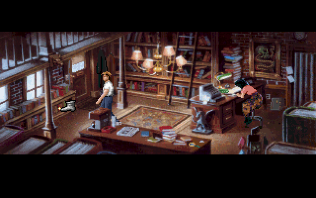

# Gabriel Knight: Sins of the Fathers — Static Recompilation

## What it is

A static recompilation of **Gabriel Knight: Sins of the Fathers** (Sierra
On-Line, 1993), the DOS CD version, to a native Windows program. The game is
scripts for Sierra's SCI virtual machine; what is recompiled is the machine
itself, the DOS interpreter `SIERRA.EXE`, a 32-bit Watcom C/C++ program bound
to DOS/4GW. pcrecomp's LE front end lifts it to C, along with the sound
drivers it loads from files at run time, and its DOS/4GW host
(`runtime/dos32`) answers DOS, DPMI, the BIOS, the VGA, the timer, the
keyboard and the mouse. The game's own scripts and resources run unchanged.
No emulator, no DOSBox, no ScummVM.

Built on the [pcrecomp](https://github.com/sp00nznet/pcrecomp) toolchain and
following its shared house style (layout, CLI, `run_lift.py` + `build.cmd`,
`Setup.cmd` quick start, launcher). The lift driver, the build and the host
window come from the
[Wacky Wheels recomp](https://github.com/sp00nznet/wackywheels-recomp).

## Status: **v0.1.0, early alpha. Day 1: you walk Gabriel around his bookshop.**

| Stage | State |
|---|---|
| Version recompiled | the DOS CD's `SIERRA.EXE` (SHA-1 `66c8fe86...`, pinned in `run_lift.py`) |
| Lift (`run_lift.py`) | 3,772 functions with the drivers, 0 errors |
| Host (`build/gk1.exe`, 64-bit, clang-cl, pcrecomp `dos32`) | builds |
| Start-up, resource and patch loading | ✅ |
| Title screen and its menu | ✅ |
| Day 1 opening: the "DAY 1" title, the dream narration, Grace in the bookshop | ✅ |
| In game: the bookshop, the verb cursors (right button), looking, walking | ✅ |
| Sound, music, speech | off: only the silent drivers (`MIDNONE.DRV`, `DACNONE.DRV`) are lifted |
| Saving and loading | untested |
| Past the bookshop | untested |
| Headless mode | `--headless` with `--seconds`, `--shot` and `--keys` (keys and mouse clicks); `--record out.mp4` does not exist yet ([ROADMAP.md](ROADMAP.md)) |
| Conformance harness | not yet ([ROADMAP.md](ROADMAP.md)) |
| `Setup.cmd` quick start, launcher | written; not yet run end to end on a clean machine |

The toolkit changes this needed are on pcrecomp's `pcrecomp-gk1` branch, not
yet in `main`: drivers loaded at run time, far calls at a selector's base, and
16-bit `pushf`/`popf`. What it took is [docs/bringup.md](docs/bringup.md).

## Screenshots

Real output of `build\gk1.exe --headless --shot`:





## What is not in this repo

Nothing from the game: no executable, no driver, no resource, no disc image,
and **no generated source**. The lifted C is produced on your machine from your
own copy by `run_lift.py`, into `src/recomp/gen/`, which is gitignored, as are
the function catalog (`analysis/`) and `work/`. The tool ships; its output
never does.

## Getting Started

You need **your own Gabriel Knight: Sins of the Fathers CD, DOS version**
(`SIERRA.EXE` and `RESOURCE.000` at its root), an `.iso` of it, or a folder
copy of it. Nothing is downloaded for you.

### Quick start: Setup.cmd

1. Download this repository (the green **Code** button, then **Download ZIP**)
   and unzip it somewhere with 1.5 GB free.
2. Double-click **`Setup.cmd`**.

It checks for Python 3.10+, the `pefile` and `capstone` packages, the pcrecomp
toolkit (on its `pcrecomp-gk1` branch) and Visual Studio 2022 with the C++
tools and clang-cl, and **asks** before installing any of them, saying what
and how big. It finds the CD in your drives, or asks where it is (a drive, a
folder, or an `.iso`, which it mounts; `Setup.cmd -GameDir E:\` skips the
question, `-Yes` answers yes to every install). Then it copies the game into
`game\`, writes a `RESOURCE.CFG` for VGA with no sound, lifts `SIERRA.EXE`
and builds `build\gk1.exe`. A rerun skips the finished steps. If it stops, it
says why in one sentence, and the details are in `setup.log`.

It ends with a **`Gabriel Knight`** shortcut in the folder.

The installer (recomp-launcher with [`launcher/launcher.json`](launcher/launcher.json))
runs the same `Setup.cmd`; there is no release of it yet.

### Step by step

Prerequisites: Windows 10/11, **Python 3.10+** (`py -3 --version`), **git**,
**Visual Studio 2022** (or its Build Tools) with *Desktop development with
C++* and *C++ Clang tools for Windows* (clang-cl), and the pcrecomp toolkit
cloned **beside** this repository as `pcrecomp`, on `pcrecomp-gk1`:

```
some-folder\
  pcrecomp\       <- git clone -b pcrecomp-gk1 https://github.com/sp00nznet/pcrecomp
  gk1\            <- this repository
```

1. Python packages:
   ```
   py -3 -m pip install --user pefile capstone
   ```
2. Copy the CD into `game\` (the movies and the Windows files are not needed):
   ```
   robocopy E:\ game /E /XD AVI SVGA WINPATCH
   ```
3. Replace the CD's `RESOURCE.CFG` (the installer's) with one for VGA and no
   sound, `game\RESOURCE.CFG`:
   ```
   videoDrv = VGA.DRV
   soundDrv = MIDNONE.DRV
   audioDrv = DACNONE.DRV
   joyDrv = NO
   patchDir = PATCHES
   ```
4. Lift (the first run also builds the function catalog and takes a minute):
   ```
   py -3 run_lift.py
   ```
   Expected: 3,772 functions, 0 errors, into `src\recomp\gen\`.
5. Build (clang-cl, CMake and Ninja, through the VS x64 environment):
   ```
   build.cmd
   ```
6. Run: `build\gk1.exe`.

The usual trip-ups: `python` opening the Microsoft Store (that is Windows' alias
placeholder; use `py -3`, or turn the alias off in *Settings > Apps > Advanced
app settings > App execution aliases*); a freshly installed Python not being on
`PATH` until you open a new window; and Visual Studio without the Clang tools
(`build.cmd` then fails to find `clang-cl`).

## Usage

The mouse plays it: the left button uses the current verb, the right button
moves to the next one (walk, look, operate, ask, talk, take, ...).

```
build\gk1.exe                                                 # in a window
build\gk1.exe --headless --seconds 20 --shot 15 title.bmp
rem PLAY, wait for the opening, five right-clicks to the walk cursor, walk
build\gk1.exe --headless --seconds 228 --keys "17:click@100;163,199:rclick@150;100,200:rclick@150;100,201:rclick@150;100,202:rclick@150;100,203:rclick@150;100,206:click@60;140" --shot 214 walk.bmp
```

| Flag | |
|---|---|
| `--game DIR` | the game folder, seen by the game as `C:\` (default `game`) |
| `--headless` | no window |
| `--seconds S` | quit after S seconds |
| `--shot S FILE` | save the screen at S seconds (up to 16) |
| `--keys "S:what,..."` | at S seconds: a key (`enter`, `space`, `esc`, `up`, ..., `key+S` holds it), or the mouse in 320x200 pixels: `click@X;Y`, `rclick@X;Y`, `move@X;Y` |
| `--log` | log the DOS host's calls |

Times are real time: the opening runs at the game's own pace.

## Building from source

Steps 4 and 5 above. `PCRECOMP` (Python, and `build.cmd` passes it to CMake as
`-DPCRECOMP=`) points at a toolkit checkout other than `..\pcrecomp`; the
lifter and the runtime must come from the same tree. On
[netlab](https://github.com/sp00nznet/recomp-netlab) the recipe is
`gk1-recomp`: `netlab build gk1-recomp`. `tools/disas.py ADDR [N]`
disassembles the relocated image with Capstone.

## License

MIT, for the code in this repository ([LICENSE](LICENSE)); credits are in
[NOTICE](NOTICE). Gabriel Knight: Sins of the Fathers is © 1993 Sierra
On-Line; none of it is here.
