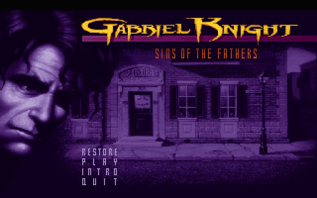
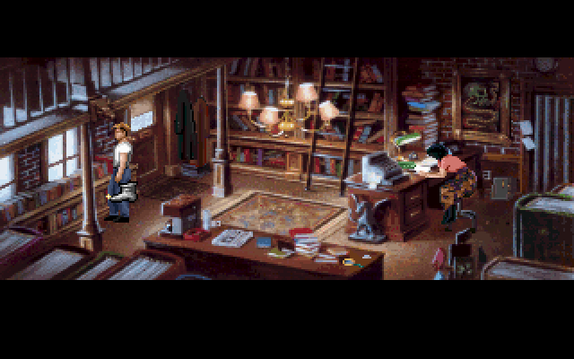

# Gabriel Knight: Sins of the Fathers — Static Recompilation

Static recompilation of **Gabriel Knight: Sins of the Fathers** (Sierra
On-Line, 1993), the DOS CD version, to a native Windows program. The game is
scripts for Sierra's SCI virtual machine; what is recompiled is the machine
itself, the DOS interpreter `SIERRA.EXE`, a 32-bit Watcom C/C++ program bound
to DOS/4GW, along with the sound drivers it loads from files at run time. The
game's own scripts and resources run unchanged on the lifted interpreter. No
emulator, no DOSBox, no ScummVM.

Built on the [pcrecomp](https://github.com/sp00nznet/pcrecomp) toolchain, on
its `main` branch: its LE front end
lifts the interpreter, and its DOS/4GW host (`runtime/dos32`) answers DOS,
DPMI, the BIOS, the VGA, the timer, the keyboard and the mouse. The lift
driver, the build and the host window come from the
[Wacky Wheels recomp](https://github.com/sp00nznet/wackywheels-recomp).

## Getting Started

You need **your own copy**: the Gabriel Knight DOS CD (`SIERRA.EXE` and
`RESOURCE.000` at its root), an `.iso` of it, or a folder copy of it. Nothing
from the game is in this repository or downloaded for you; everything is
built on your machine from your copy.

### The setup scripts

1. Download this repository (the green **Code** button, then **Download ZIP**)
   and unzip it somewhere with 1.5 GB free.
2. Windows: double-click **`Setup.cmd`**. Linux and macOS: not yet
   (`setup.sh` says so and stops).
3. Play with the **`Gabriel Knight`** shortcut in that folder.

The script checks for Python 3.10+ (with `pefile` and `capstone`), Git, the
pcrecomp toolkit (cloned beside this folder) and
Visual Studio 2022 with clang-cl, and asks before installing any of them. It
finds the CD in your drives or asks where it is (`Setup.cmd -GameDir E:\`
skips the question, `-Yes` answers yes to every install), copies it into
`game\`, writes a `RESOURCE.CFG` for VGA with no sound, lifts `SIERRA.EXE` and
builds `build\gk1.exe`. A rerun skips finished steps; if it stops, it says why
in one sentence and the details are in `setup.log`. Building by hand and the
command line are in **[docs/building.md](docs/building.md)**.

The game is played with the mouse: the left button uses the current verb, the
right button moves to the next one (walk, look, operate, ask, talk, take, ...).

## Status

**v0.1.0, early alpha: day 1, walking Gabriel around his bookshop.** The
interpreter lifts with 0 errors and runs the title screen, the day 1 opening
and the bookshop, where Gabriel walks and looks where you click.

| Stage | State |
|---|---|
| Version recompiled | the DOS CD's `SIERRA.EXE` (SHA-1 `66c8fe86...`, pinned in `run_lift.py`) |
| Lift (`run_lift.py`) | 3,772 functions with the drivers, 0 errors |
| Host (`build/gk1.exe`, 64-bit, clang-cl, pcrecomp `dos32`) | builds |
| Start-up, resource and patch loading | ✅ |
| Title screen and its menu | ✅ |
| Day 1 opening: the "DAY 1" title, the dream narration, Grace in the bookshop | ✅ |
| In game: the bookshop, the verb cursors, looking, walking | ✅ |
| Sound, music, speech | off: only the silent drivers (`MIDNONE.DRV`, `DACNONE.DRV`) are lifted |
| Saving and loading, past the bookshop | untested |
| Headless mode | `--headless`, `--seconds`, `--shot`, `--keys` (keys and mouse clicks); no `--record` yet |
| Conformance harness | not yet ([ROADMAP.md](ROADMAP.md)) |
| `Setup.cmd` | tested from a fresh clone against a folder copy of the CD |
| Linux, macOS | not yet |

[docs/bringup.md](docs/bringup.md) is the log of each wall and its fix, and
[ROADMAP.md](ROADMAP.md) what comes next.

## Screenshots

Real output of `build\gk1.exe --headless --shot`:

## Documentation

- [docs/building.md](docs/building.md): building by hand, the command line, netlab
- [docs/testing.md](docs/testing.md): headless runs, scripted keys and clicks, screenshots
- [docs/bringup.md](docs/bringup.md): every wall so far and its fix
- [ROADMAP.md](ROADMAP.md), [CHANGELOG.md](CHANGELOG.md), [CONTRIBUTING.md](CONTRIBUTING.md)

## Contributors

See **[CONTRIBUTORS.md](CONTRIBUTORS.md)** for who did what.

## License

MIT for this repository's own code ([LICENSE](LICENSE)). Gabriel Knight: Sins
of the Fathers is © 1993 Sierra On-Line; none of its files, and nothing
generated from them, is in this repository ([NOTICE.md](NOTICE.md)).
